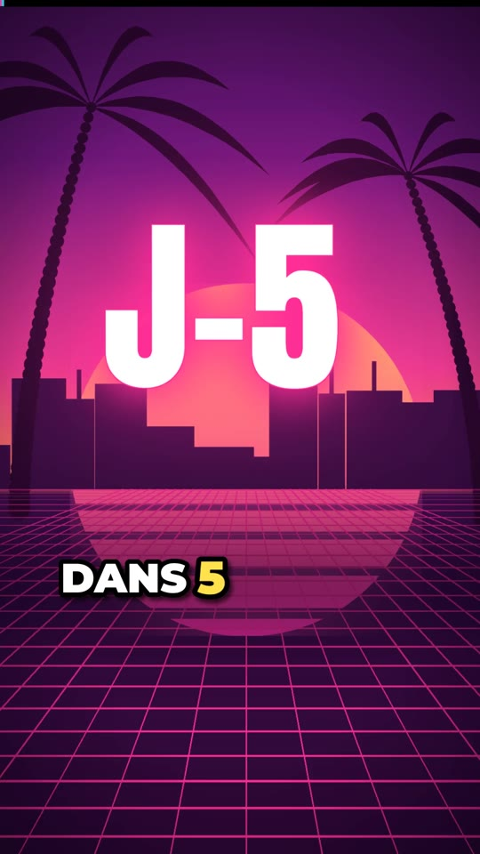

# GTA 6 · Vidéo TikTok 60 s (J-5)

**Vidéo :** [`GTA6_TikTok_60s.mp4`](GTA6_TikTok_60s.mp4), 1080×1920 (9:16), 30 fps, 60 s, sous-titres incrustés.

Les visuels sont 100 % originaux et d'inspiration Vice City (néons, coucher de soleil, palmiers, grille synthwave). Ils ne reprennent aucun extrait, logo ou personnage officiel de Rockstar. La musique, les effets sonores et la voix de synthèse sont générés pour la vidéo.

Infos vérifiées le 14/11/2026 : sortie le **jeudi 19 novembre 2026** sur **PS5 et Xbox Series X|S** (pas de version PC annoncée), édition standard à **79,99 €**, préchargement déjà ouvert.

---

## 1. Script de la voix off

| Timecode | Partie | Voix off |
|---|---|---|
| 0:00 – 0:03 | HOOK | Dans 5 jours, plus personne ne va aller au travail. |
| 0:03 – 0:06 | CONTEXTE | Treize ans. Treize ans qu'on attend depuis GTA 5. |
| 0:06 – 0:10 | CONTEXTE | Deux reports plus tard… cette fois, c'est la bonne. |
| 0:10 – 0:16 | INFO 1/5 | Un : la date. Jeudi 19 novembre, dans la nuit de mercredi à jeudi. |
| 0:16 – 0:22 | INFO 2/5 | Deux : PS5 et Xbox Series seulement. Le prix : 79,99 €. |
| 0:22 – 0:28 | INFO 3/5 | Trois : retour à Vice City, dans l'État de Leonida. Le Miami de Rockstar. |
| 0:28 – 0:34 | INFO 4/5 | Quatre : deux héros, Lucia et Jason. Un duo façon Bonnie and Clyde. |
| 0:34 – 0:40 | INFO 5/5 | Cinq : le préchargement est déjà ouvert. Lance-le maintenant, ça va être lourd. |
| 0:40 – 0:46 | DÉBAT | Alors, vraie question : tu poses ta journée le 19… ou tu te fais porter pâle ? |
| 0:46 – 0:52 | DÉBAT | Et toi, tu joues Lucia ou Jason ? Dis-le en commentaire. |
| 0:52 – 0:57 | CTA | Abonne-toi pour tout savoir le jour J. |
| 0:57 – 1:00 | BOUCLE | Parce que dans 5 jours… *(→ la vidéo repart sur « …plus personne ne va aller au travail »)* |

## 2. Découpage plan par plan

Un changement de plan toutes les 1,5 à 2 s (zoom ou panoramique, décor qui change). Il y a un flash blanc et un whoosh à chaque coupe, plus fort à chaque nouvelle partie. La barre de progression rose → cyan reste en haut pendant toute la vidéo. Le badge **J-5 ⏳** est en haut à gauche de 0:03 à 0:57.

| Timecode | Visuel | Texte à l'écran | Son | Transition |
|---|---|---|---|---|
| 0:00 | Coucher de soleil rayé, grille néon, palmiers | **J-5** géant (rose néon, pulse) | Boum grave + nappe synthwave | Ouverture directe |
| 0:02 | Tunnel néon | « NO WORK » incliné (cyan) | Whoosh léger | Flash |
| 0:03 | Skyline de nuit, fenêtres néon | 2013 → 2026, **13 ANS** (jaune) | Charleston qui démarre | Flash + whoosh |
| 0:06 | Tunnel / ville | « 2025 » et « MAI 2026 » tamponnés **REPORTÉ** (rouge) | Roulement de caisse claire + riser | Flash |
| 0:08 | Ville | **19.11.2026** (cyan) | Riser qui monte, coupure | — |
| 0:10 | Grille néon | Pastille **1/5**, **19.11** géant, **JEUDI**, « NUIT DU 18 AU 19 » | **DROP** : boum + basse + batterie complète | Gros flash |
| 0:12 – 0:16 | Autoroute (traînées de phares), tunnel | idem | Bass boost sur « 19 » | Coupes 1,8 s |
| 0:16 | Ville / tunnel | Pastille **2/5**, cartes **PS5** et **XBOX SERIES X\|S**, « PC : PAS ANNONCÉ » | Pop + arpège lead | Flash |
| 0:19 | idem | Étiquette **79,99 €** (jaune, oscille) | **Caisse enregistreuse** | — |
| 0:22 | Plage au coucher de soleil, ville | Pastille **3/5**, enseigne **VICE / CITY** qui grésille, « ÉTAT DE LEONIDA » | Pop | Flash |
| 0:28 | Autoroute, grille, ville | Pastille **4/5**, cartes silhouettes **LUCIA** (rose) / **JASON** (cyan), « BONNIE & CLYDE » | Pop | Flash |
| 0:34 | Tunnel, grille, autoroute | Pastille **5/5**, barre **PRÉCHARGEMENT** de 0 à 100 %, **LANCE-LE !** | Pop | Flash |
| 0:40 | Ville, plage | **VRAIE QUESTION** + sondage animé « JE POSE MA JOURNÉE 62 % / JE SUIS « MALADE » 38 % » | Breakdown (batterie allégée) | Flash |
| 0:46 | Tunnel, autoroute | **LUCIA** ou **JASON** + 👇 qui rebondit | idem | Flash |
| 0:52 | Grille, ville | Bouton **ABONNE-TOI** qui pulse, « JOUR J = 19.11 » | Batterie complète | Flash |
| 0:57 | Tunnel → grille | **J-5** géant qui grossit (raccord avec la 1re image) | Riser → boucle | Raccord en boucle |

## 3. Sous-titres (mot par mot, Montserrat Black blanc + contour noir, mots-clés en **jaune / rose néon**)

Les sous-titres sont centrés à gauche de l'écran, hors des zones d'interface TikTok (bas et colonne de droite). Chaque mot apparaît avec un léger pop et les mots-clés déclenchent un punch-in (zoom rapide) de toute l'image.

- DANS **5 JOURS** PLUS PERSONNE NE VA ALLER AU **TRAVAIL** 😳
- **13 ANS** 13 ANS QU'ON ATTEND DEPUIS **GTA 5**
- **2 REPORTS** PLUS TARD… CETTE FOIS C'EST LA **BONNE** 🔥
- **1** LA **DATE** JEUDI **19 NOVEMBRE** DANS LA NUIT DE MERCREDI À JEUDI
- **2** **PS5** ET **XBOX SERIES** SEULEMENT LE PRIX **79,99 €** 💰
- **3** RETOUR À **VICE CITY** DANS L'ÉTAT DE **LEONIDA** LE MIAMI DE ROCKSTAR 🌴
- **4** DEUX HÉROS **LUCIA** ET **JASON** UN DUO FAÇON **BONNIE & CLYDE**
- **5** LE **PRÉCHARGEMENT** EST DÉJÀ OUVERT LANCE-LE **MAINTENANT** ÇA VA ÊTRE LOURD 🎮
- ALORS VRAIE QUESTION TU **POSES TA JOURNÉE** LE 19… OU TU TE FAIS **PORTER PÂLE ?**
- ET TOI TU JOUES **LUCIA** OU **JASON ?** DIS-LE EN **COMMENTAIRE** 👇
- **ABONNE-TOI** POUR TOUT SAVOIR LE **JOUR J**
- PARCE QUE DANS **5 JOURS…**

## 4. Trois hooks à tester

1. **« Dans 5 jours, plus personne ne va aller au travail. »** *(celui de la vidéo : humour + urgence)*
2. **« 13 ans d'attente. Il reste 5 jours. »** *(émotion + compte à rebours)*
3. **« Si t'as pas encore lancé le préchargement, t'es déjà en retard. »** *(peur de rater quelque chose, pousse à l'action)*

## 5. Légende TikTok + hashtags

> GTA 6 dans 5 jours 🔥 Tu poses ta journée le 19 ou tu te fais porter pâle ? 👇

`#GTA6` `#GTAVI` `#ViceCity` `#gaming` `#jeuxvideo` `#PS5` `#fyp` `#pourtoi`

## 6. Quand publier + suites

- **Quand publier :** ce soir (samedi 14/11) entre **19 h et 21 h**, heure de France. La vidéo dit « J-5 », donc elle n'est juste qu'aujourd'hui. Si tu publies demain, change le hook et le badge en « J-4 ».
- **Suite n° 1 (le 18 au soir) :** « J-0 : à quelle heure tu peux lancer GTA 6 chez toi », avec un compte à rebours en direct et la checklist (préchargement, espace disque, manette chargée).
- **Suite n° 2 (le 19 ou le 20) :** « Les 5 premières choses à faire dans GTA 6 », ou un format réaction « Ce qui m'a choqué dans la 1re heure », pour reprendre le débat Lucia vs Jason en commentaires.

---

*Fichiers de production :* `script.py` (texte), `timing.py` (minutage des sous-titres), `render.py` (images), `audio.py` (musique, effets, mixage).
